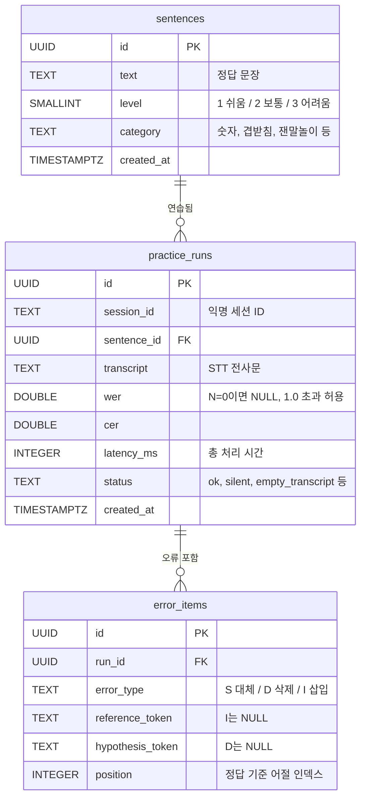

# ERD (Entity Relationship Diagram)

## 관계 설명

| 관계 | 카디널리티 | 삭제 정책 |
|---|---|---|
| sentences → practice_runs | 1 : N (한 문장을 여러 번 연습) | 문장 삭제 시 이력도 삭제(CASCADE) |
| practice_runs → error_items | 1 : N (한 시도에 여러 오류, 0건 가능) | 시도 삭제 시 오류도 삭제(CASCADE) |

## 설계 결정

- **음성 원본 컬럼 없음:** 개인정보 보호를 위해 전사문·지표만 저장합니다.
- **session_id는 TEXT:** 로그인 없이 브라우저 세션별 `uuid4`로 구분합니다(비공개 보장 불가).
- **status CHECK 제약:** 장애 유형별 집계를 위해 허용 값을 고정했습니다.
- **인덱스:** `(session_id, created_at)` 이력 조회용, `sentence_id` 문장별 비교용, `run_id` 오류 조회용.
- 스키마 원본: `sql/schema.sql`
